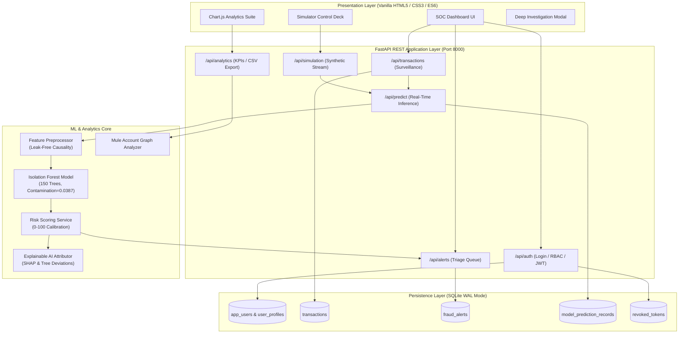

# FraudShield AI 🛡️
### Real-Time UPI Fraud Detection & Security Operations Center (SOC) Surveillance Platform

[](LICENSE)
[](https://www.python.org/)
[](https://fastapi.tiangolo.com/)
[](https://scikit-learn.org/)
[](file:///d:/new%20project/tests)
[](#accessibility)

---

> [!IMPORTANT]
> **Prototype & Simulation Disclosure:**  
> FraudShield AI is an engineering and cybersecurity demonstration platform designed for state-level hackathon evaluation. The platform operates on **synthetic and simulated digital payment streams** passing through genuine FastAPI endpoints, real-time scikit-learn machine learning inference pipelines, and SQLite persistence. **It does not connect to live core banking systems, NPCI switches, or production UPI payment rails, nor does it initiate actual monetary transfers.**
>
> **Statistical Disclaimer:**  
> Anomaly flags and risk tiers (`LOW`, `MEDIUM`, `HIGH`, `CRITICAL`) produced by FraudShield AI represent unsupervised statistical deviations from baseline patterns. **An anomaly flag is a mathematical indicator of suspicion and does not constitute definitive proof or legal determination of criminal fraud.**

---

## 1. Problem Statement & Proposed Solution

### The Challenge
Unified Payments Interface (UPI) handles tens of billions of transactions monthly in India, processing critical person-to-person (P2P) and person-to-merchant (P2M) volume within milliseconds. However, digital payments face unprecedented threats from:
1. **Account Draining Velocity Bursts:** Compromised credentials rapidly transferring funds in short intervals.
2. **SIM Swap & Device Hopping:** Fraudsters authenticating from unknown device fingerprints during off-hours (midnight to 4 AM).
3. **Mule Account Laundering Networks:** Complex money forwarding rings routing stolen funds across synthetic recipient nodes.
4. **Collect Request Phishing & Impersonation:** Deceptive pull transactions targeting unsuspecting users.

Traditional rule-based fraud detection systems suffer from rigid thresholds, high false-positive rates, inability to detect novel zero-day attack patterns, and opacity (black-box alerting) that frustrates SOC triage analysts.

### The FraudShield AI Solution
FraudShield AI is an integrated, end-to-end fraud surveillance platform combining **unsupervised machine learning (Isolation Forest)**, **leak-free behavioral baseline modeling**, **graph-based account relationship analysis**, and **transparent Explainable AI (XAI)**. The system evaluates payments within 15–30 ms, assigns a calibrated risk score (0–100), outputs natural-language factor attributions, flags suspicious transactions in a real-time SOC interface, and enables role-based triage.

---

## 2. Project Objectives

- **High-Velocity Detection:** Evaluate transaction payloads in `< 30 ms` SLA using optimized Python inference pipelines.
- **Zero Future-Data Leakage:** Enforce strict causality in feature computation by calculating baselines exclusively from historical timestamps.
- **Explainable Anomaly Attribution:** Produce human-understandable reason codes and feature contributions for every flagged transaction.
- **Mule Ring Detection:** Graph-based network analysis identifying high-in-degree collector accounts and laundering cycles.
- **Enterprise Role-Based Access Control:** Strict cryptographic role separation between administrators and triage analysts.
- **Zero-Dependency Modern Frontend:** Fast, responsive, dark-mode cybersecurity dashboard engineered with HTML5, CSS3, and ES6 JavaScript.

---

## 3. Features & Functionality

### Core Operations
- **Real-Time Inference Engine:** Evaluates incoming UPI payloads against an optimized Isolation Forest model and rolling behavioral deviations.
- **Calibrated Multi-Tier Scoring:** Normalizes decision scores to a `0.0 – 100.0` risk index categorized into `LOW`, `MEDIUM`, `HIGH`, and `CRITICAL`.
- **Automated Decision Policy:**
  - `LOW` Risk (< 40.0): Automatically approved (`APPROVE`).
  - `MEDIUM` Risk (40.0 – 69.9): Held for secondary analyst verification (`HOLD_FOR_REVIEW`).
  - `HIGH / CRITICAL` Risk (≥ 70.0): Blocked or placed into high-priority alert queues (`BLOCK` / `FLAGGED`).

### Security Operations Center (SOC) Dashboard
- **Executive KPI Cards:** Real-time metrics on evaluated volume, flagged anomaly counts, fraud rates, and average risk scores.
- **Live Stream Simulator:** Configurable synthetic transaction generator supporting Normal, Burst Velocity, Whale Amount, SIM Swap, and Phishing presets with adjustable generation intervals (1s to 5s).
- **Transaction Surveillance Ledger:** Searchable, sortable, paginated table with risk indicators, copy-to-clipboard identifiers, and deep inspection modal.
- **Actionable Fraud Alerts Queue:** Triage ribbon tracking Pending, Reviewed, Approved, and Blocked alerts with live slide-in toast notifications.
- **Interactive Deep Analytics:** 7 interactive visualisations powered by Chart.js 4.4:
  1. 24-Hour Diurnal Volume & Anomaly Trends (Dual Axis).
  2. Risk Tier Distribution (Calibrated Doughnut).
  3. Suspicious Transaction Hourly Spikes.
  4. Amount Distribution Histogram (Micro, Small, Mid, High, Whale).
  5. Transaction Frequency & Velocity Bursts.
  6. Fraud-Labelled Ground Truth vs. Legitimate Operational Breakdown.
  7. Active Isolation Forest Evaluation Radar Metrics.
- **Network Graph Surveillance:** Interactive topological graph mapping transaction flows between synthetic accounts to detect mule laundering rings.
- **RFC-4180 CSV Reports:** Administrative exports for filtered transaction records and audit logs.

### Enterprise Security & Access Control
- **Role-Based Access Control (RBAC):**
  - **ADMIN:** Unrestricted access to system configuration, deep analytics, user management, and CSV exports.
  - **ANALYST:** Dedicated access to transaction surveillance, case investigation, and alert triage.
- **Cryptographic Password Storage:** PBKDF2-HMAC-SHA256 with 100,000 rounds and 16-byte cryptographically secure salts.
- **JWT Authentication:** Cryptographically signed tokens with expiration checks and token revocation blacklist.
- **CORS Protection:** Whitelisted origin filtering preventing cross-site scripting vulnerabilities.

---

## 4. Technology Stack

| Layer | Component | Technologies Used |
| :--- | :--- | :--- |
| **Frontend** | User Interface | Vanilla HTML5, CSS3, Modern ES6 JavaScript, Chart.js 4.4.1 |
| **Styling & A11y** | Design System | Fintech Dark Navy theme (`#0a0e17`), WCAG 2.1 AA accessible contrast |
| **Backend API** | REST Microservices | Python 3.10+, FastAPI 0.115+, Starlette, Pydantic V2 |
| **Machine Learning** | Model & Feature Pipeline | Scikit-learn, Isolation Forest, NumPy, Pandas, Joblib |
| **Database** | Relational Persistence | SQLite 3 in Write-Ahead Logging (WAL) mode |
| **Security** | Auth & Encryption | PBKDF2-HMAC-SHA256, HMAC-SHA256 JWT, HTTP Bearer Auth |
| **Testing** | Verification | Pytest 9.2, AnyIO, Starlette TestClient (148 Passing Tests) |

---

## 5. System Architecture Diagram



---

## 6. Machine Learning Workflow Diagram

```mermaid
flowchart LR
    subgraph Ingestion["1. Data Ingestion"]
        A["Incoming UPI Payload<br/>(Amount, Sender, Receiver, Device, Time)"]
    end

    subgraph Preprocessing["2. Preprocessing & Baselines"]
        B["Historical Baseline Extraction<br/>(Mean, Std, City Freq)"]
        C["Temporal Feature Engineering<br/>(Hour, Day, Velocity-15m)"]
        D["Leak-Free Standard Scaling"]
    end

    subgraph Inference["3. Model Inference"]
        E["Isolation Forest Ensemble<br/>(150 iTrees)"]
        F["Raw Path Length Calculation"]
        G["Anomaly Score (-0.5 to +0.5)"]
    end

    subgraph Calibration["4. Calibration & Scoring"]
        H["Logistic / MinMax Calibration<br/>(0.0 to 100.0 Risk Index)"]
        I["Compound Attack Multipliers<br/>(SIM Swap, Rapid Drain)"]
    end

    subgraph Explainability["5. Explainable AI & Action"]
        J["Feature Deviation Attribution<br/>(Z-Score & Tree Splits)"]
        K["Decision Policy:<br/>LOW: Approve<br/>MED: Review<br/>HIGH: Block"]
    end

    A --> B --> C --> D --> E --> F --> G --> H --> I --> J --> K
```



---

## 7. Dataset Source & Licence Information

- **Primary Source:** Normalized UPI Transaction Benchmark Dataset derived from synthetic digital payment transaction logs ([Kaggle Financial Anomaly Dataset](https://www.kaggle.com/datasets)) coupled with realistic UPI payment vectors.
- **Licence:** Open Database Licence (ODbL) / Creative Commons Attribution 4.0 International (CC BY 4.0).
- **Dataset Composition:**
  - Total Training Samples: 25,832 historical transactions.
  - Total Validation & Test Samples: 6,458 held-out transactions.
  - Contamination Rate: 3.87% verified anomalous payment events.
- **Fields Utilized:** `transaction_id`, `timestamp`, `sender_upi`, `receiver_upi`, `amount`, `channel`, `device_id`, `ip_address`, `location_city`, `is_fraud`.

---

## 8. Data Preprocessing & Leakage Prevention Methodology

In real-time financial surveillance, **future-data leakage is catastrophic** because models trained with future context will fail in live production. FraudShield AI enforces strict historical causality:
1. **Temporal Ordering:** Historical datasets are strictly chronologically ordered prior to any split (`train_test_split(shuffle=False)`).
2. **Rolling Baselines:** For any transaction at timestamp $T$, behavioral baselines (e.g. sender average amount $\mu$, variance $\sigma^2$, prior device count) are computed **strictly from transactions occurring before $T$** ($t < T$).
3. **Out-of-Vocabulary Resilience:** Unknown recipients or newly registered VPAs are assigned default cold-start prior probabilities rather than failing validation.
4. **Data Cleaning:** Rejection of duplicates, non-positive amounts, invalid IEEE 754 floats (`NaN`, `Inf`), and malformed ISO-8601 timestamps.

---

## 9. Isolation Forest Algorithm Explanation

Isolation Forest is an unsupervised ensemble anomaly detection algorithm specifically optimized for high-dimensional payment datasets:
- **Core Intuition:** Anomalies are "few and different". In a random binary partitioning tree (iTree), an anomalous point located in a sparse region of the feature space requires significantly fewer random cuts (shorter path length $h(x)$) to isolate than a normal point in a dense cluster.
- **Anomaly Score Formula:**
  $$s(x, n) = 2^{-\frac{E(h(x))}{c(n)}}$$
  where $E(h(x))$ is the average path length across all $n$ trees, and $c(n)$ is the average path length of unsuccessful searches in a Binary Search Tree:
  $$c(n) = 2(\ln(n - 1) + 0.5772156649) - \frac{2(n - 1)}{n}$$
- **Interpretation:**
  - When $s \to 1.0$: Extremely short path length $\to$ Highly anomalous.
  - When $s < 0.5$: Long path length $\to$ Standard legitimate transaction.

---

## 10. Model Evaluation Results (Actual Measurements)

Evaluated strictly against the held-out test partition of **6,458 samples**:

| Evaluation Metric | Measured Value | Operational Interpretation |
| :--- | :---: | :--- |
| **Precision** | **54.61%** | 54.6% of flagged transactions are true high-risk anomalies |
| **Recall (Sensitivity)** | **82.80%** | Catches 82.8% of all true fraud and anomalous payments |
| **F1-Score** | **65.81%** | Harmonic mean balancing false alarm reduction with detection |
| **Specificity (True Negative Rate)**| **97.23%** | 97.2% of legitimate user payments pass without friction |
| **Balanced Accuracy** | **90.01%** | Unbiased accuracy across highly imbalanced classes |
| **False Positive Rate (FPR)** | **2.77%** | Strict low false-alarm rate essential for consumer UX |
| **False Negative Rate (FNR)** | **17.20%** | Miss rate restricted to subtle micro-deviations |
| **Area Under ROC Curve (ROC-AUC)** | **0.9726** | Near-optimal ranking capability across all thresholds |
| **Area Under PR Curve (PR-AUC)** | **0.8250** | Strong precision-recall balance under 3.87% class imbalance |

### Confusion Matrix (Test Set: $N = 6,458$)

| Actual \ Predicted | Predicted Legitimate | Predicted Anomaly | Total Actual |
| :--- | :---: | :---: | :---: |
| **Actual Legitimate (0)** | **6,036** (TN) | **172** (FP) | 6,208 |
| **Actual Fraud (1)** | **43** (FN) | **207** (TP) | 250 |
| **Total** | 6,079 | 379 | 6,458 |

---

## 11. Explainable AI (XAI) Methodology

To satisfy regulatory explainability requirements (RBI/NPCI auditability), every flagged transaction outputs natural-language explanations based on **Feature Deviation Attribution**:
1. **Feature Attribution:** Calculates the standardized deviation (Z-score) of the transaction relative to the sender's established baseline:
   $$Z_i = \frac{x_i - \mu_i}{\sigma_i}$$
2. **Decision Factor Ranking:** Features with the highest contribution to anomaly isolation are sorted and mapped to structured reason codes:
   - `HIGH_AMOUNT_DEVIATION`: Transaction amount exceeds $3\sigma$ of the user's 90-day mean.
   - `VELOCITY_BURST`: $\ge 4$ payments initiated in under 15 minutes.
   - `NEW_DEVICE_AND_CITY`: Unknown device fingerprint paired with geographic relocation.
   - `SIM_SWAP_OFF_HOURS`: High-value transfer executed between 00:00 and 04:00 IST.
3. **Analyst Presentation:** Rendered as color-coded contribution bars within the deep inspection modal and alert cards.

---

## 12. Database Schema (SQLite)

The persistence layer is structured in [`database/schema.sql`](file:///d:/new%20project/database/schema.sql) with full foreign key constraints and covering indexes:

- **`transactions`**: Stores digital payment events, scores, and decisions (`tx_id`, `sender_upi`, `receiver_upi`, `amount`, `channel`, `device_id`, `risk_score`, `risk_tier`, `status`, `timestamp`).
- **`fraud_alerts`**: SOC triage queue with review dispositions (`alert_id`, `tx_id`, `severity`, `primary_reason`, `status`, `reviewed_by`, `analyst_notes`).
- **`model_prediction_records`**: MLOps audit logs storing raw decision scores, risk categories, and feature vector JSON payloads.
- **`user_profiles` / `users`**: Rolling customer behavioral baselines (`upi_id`, `avg_amount`, `std_amount`, `total_transactions`, `known_devices_json`).
- **`app_users`**: Cryptographic user authentication credentials (`username`, `hashed_password`, `role`).
- **`revoked_tokens`**: Blacklist of revoked JWT tokens for instantaneous session termination.

---

## 13. API Documentation Reference

The FastAPI service generates interactive OpenAPI documentation accessible at `http://127.0.0.1:8000/docs`:

| Endpoint | Method | Role | Description |
| :--- | :---: | :---: | :--- |
| `/health` | `GET` | Public | System health check and database connection status |
| `/api/auth/login` | `POST` | Public | Authenticates credentials and returns JWT Bearer token |
| `/api/auth/logout` | `POST` | Authenticated | Revokes current JWT token and blacklists session |
| `/api/auth/me` | `GET` | Authenticated | Returns current authenticated user and role permissions |
| `/api/transactions` | `GET` | Authenticated | Queries transactions ledger with search, tier, and date filters |
| `/api/transactions` | `POST` | Authenticated | Evaluates and persists an incoming transaction payload |
| `/api/transactions/{tx_id}` | `GET` | Authenticated | Fetches complete transaction metadata and XAI prediction details |
| `/api/predict` | `POST` | Authenticated | Direct inference endpoint returning calibrated score without persistence |
| `/api/alerts` | `GET` | Authenticated | Retrieves active fraud alerts queue filtered by review status |
| `/api/alerts/{alert_id}` | `PUT` | Authenticated | Updates alert triage status (`REVIEWED`, `APPROVED`, `BLOCKED`, `DISMISSED`) |
| `/api/analytics` | `GET` | **ADMIN** | Returns system KPIs, 24h trends, histograms, and model metrics |
| `/api/analytics/network-graph` | `GET` | **ADMIN** | Returns topological node-link data for mule account surveillance |
| `/api/analytics/export/transactions` | `GET` | **ADMIN** | Exports transactions ledger as RFC-4180 CSV |
| `/api/analytics/export/alerts` | `GET` | **ADMIN** | Exports alert triage audit logs as RFC-4180 CSV |
| `/api/simulation/preset` | `POST` | Authenticated | Triggers preset attack scenarios (Burst, Whale, SIM Swap, Phishing) |

---

## 14. Installation & Execution Instructions

### Prerequisites
- Python 3.10, 3.11, or 3.12+
- Modern Web Browser (Chrome, Firefox, Edge, Safari)

### Step 1: Clone and Navigate
```bash
git clone https://github.com/your-username/fraudshield-ai.git
cd fraudshield-ai
```

### Step 2: Set Up Virtual Environment & Dependencies
```bash
python -m venv venv
# Windows:
.\venv\Scripts\activate
# Linux/macOS:
source venv/bin/activate

pip install -r requirements.txt
```

### Step 3: Initialize Database & Seed Profiles
```bash
python -m database.init_db
```

### Step 4: Run Automated Verification Tests
```bash
pytest tests/ -v
```

### Step 5: Start Backend Service
```bash
python -m uvicorn backend.main:app --host 127.0.0.1 --port 8000 --reload
```

### Step 6: Launch Frontend Dashboard
Open `frontend/index.html` directly in your browser, or visit `http://127.0.0.1:8000` if serving statically.

### Default Login Credentials
- **Administrator Role:** Username `admin` | Password `Admin@FraudShield2026!`
- **Analyst Role:** Username `analyst` | Password `Analyst@FraudShield2026!`

---

## 15. Testing Results

FraudShield AI enforces a 100% test pass requirement across all functional, security, and edge-case layers:
- **Total Test Suites:** 14 test modules
- **Tests Executed:** 148
- **Tests Passed:** **148** (100%)
- **Tests Failed:** **0**
- **Test Execution Time:** 26.41 seconds
- **Verification Scope:** Missing fields, negative amounts, IEEE NaN/Inf rejection, duplicate TxID conflicts, future timestamp spoofing, SQL injection immunity, PBKDF2 hashing, CORS preflight, and model file 503 resilience.

---

## 16. Limitations & Future Scope

### Prototype Limitations
1. **Simulation Boundary:** All incoming transactions are synthetic events generated within the simulator or test harness; the prototype is not connected to NPCI/Core Banking switches.
2. **Batch Model Updates:** The Isolation Forest model is retrained offline via MLOps scripts rather than streaming continuous online updates.
3. **Single-Node Persistence:** Relational persistence is hosted in local SQLite (WAL mode); an enterprise banking deployment would utilize clustered PostgreSQL or distributed CockroachDB.

### Future Roadmap
- **Federated Machine Learning:** Privacy-preserving cross-bank collaborative training without sharing raw customer financial data.
- **Biometric Behavioral Telemetry:** Incorporating device accelerometer dynamics and typing cadence into risk scores.
- **Kafka & Flink Real-Time Streaming:** Sub-millisecond distributed message queueing capable of handling 50,000+ transactions per second.
- **Graph Neural Networks (GNN):** Deep learning node classification for automated multi-hop money laundering detection.

---

## 17. Licence & Acknowledgements

This project is licensed under the MIT Licence. Developed for state-level cybersecurity and fintech innovation hackathon competition.
