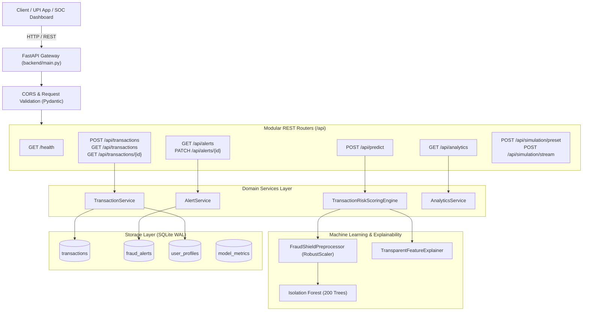

# FraudShield AI - REST API Gateway Specification

## 1. Overview & Architecture

The **FraudShield AI REST API Gateway** is built on **FastAPI** to deliver low-latency real-time fraud scoring, anomaly detection, explainable alerts, and audit ledger management for Indian digital payments and UPI transfers.



---

## 2. API Endpoints Reference

All endpoints support both `/api/...` and `/api/v1/...` for backward compatibility.

### 2.1 Health & Diagnostics
* **Path**: `GET /health`
* **Tags**: `Health & System`
* **Description**: Verifies SQLite connectivity, baseline user profiles count, and in-memory presence of the Scikit-Learn Isolation Forest model.
* **Success Response (200 OK)**:
```json
{
  "status": "healthy",
  "project": "FraudShield AI",
  "version": "1.0.0",
  "timestamp": "2026-10-31T00:19:30Z",
  "database": {
    "status": "healthy",
    "path": "d:/new project/database/fraudshield.db",
    "baseline_users_loaded": 5,
    "total_transactions": 28
  },
  "ml_capabilities": {
    "isolation_forest": "loaded (scikit-learn)",
    "status": "healthy",
    "details": {
      "status": "loaded",
      "model_type": "IsolationForest",
      "n_estimators": 200,
      "contamination": 0.035,
      "feature_count": 13
    }
  }
}
```

---

### 2.2 Submit & Evaluate Transaction
* **Path**: `POST /api/transactions`
* **Tags**: `Transactions`
* **Description**: Real-time evaluation of an incoming UPI payment. Runs model inference, computes calibrated risk score (0–100), generates explainability factors, persists the transaction to SQLite, and automatically logs actionable alerts for Medium/High risk incidents.
* **Request Body**:
```json
{
  "sender_upi": "arjun.sharma@okaxis",
  "receiver_upi": "kirana.store@icici",
  "amount": 350.0,
  "channel": "QR_CODE",
  "device_id": "DEV-XIAOMI-12",
  "ip_address": "49.207.180.12",
  "location_city": "Mumbai"
}
```
* **Success Response (201 Created)**:
```json
{
  "tx_id": "UPI-20261031-849201",
  "sender_upi": "arjun.sharma@okaxis",
  "receiver_upi": "kirana.store@icici",
  "amount": 350.0,
  "channel": "QR_CODE",
  "risk_score": 12.45,
  "risk_tier": "LOW",
  "risk_category": "Low risk",
  "status": "APPROVE",
  "action_recommendation": "APPROVE",
  "primary_factor": "NORMAL_TRANSACTION",
  "is_flagged": false,
  "explanations": [
    {
      "factor_name": "AMOUNT_VS_HISTORICAL_BASELINE",
      "weight": 0.20,
      "severity": "NORMAL",
      "description": "Amount ₹350.00 is well within user average (₹1,500.00)."
    }
  ],
  "alert_id": null,
  "evaluated_at": "2026-10-31T00:19:35Z"
}
```

---

### 2.3 Direct Machine Learning Inference
* **Path**: `POST /api/predict`
* **Tags**: `Machine Learning Inference`
* **Description**: Stateless prediction endpoint for ML evaluation without requiring database mutation.
* **Success Response (200 OK)**:
```json
{
  "transaction_id": "UPI-20261031-193847",
  "is_anomaly": false,
  "prediction_label": "NORMAL",
  "raw_decision_score": 0.1245,
  "anomaly_score": 20.91,
  "risk_score": 18.50,
  "risk_tier": "LOW",
  "risk_category": "Low risk",
  "action_recommendation": "APPROVE",
  "primary_factor": "NORMAL_TRANSACTION",
  "relevant_risk_indicators": [
    "Transaction conforms to customer historical baseline and diurnal activity."
  ],
  "explanations": [ ... ],
  "model_version": "IsolationForest-v1.0",
  "evaluated_at": "2026-10-31T00:19:35Z"
}
```

---

### 2.4 List Transactions Ledger
* **Path**: `GET /api/transactions`
* **Tags**: `Transactions`
* **Query Parameters**:
  - `limit`: int (default: 50, max: 500)
  - `offset`: int (default: 0)
  - `risk_tier`: string (`LOW`, `MEDIUM`, `HIGH`, `CRITICAL`)
  - `sender_upi`: string (substring search)
  - `is_flagged`: int (`0` or `1`)
* **Success Response (200 OK)**:
```json
{
  "total": 120,
  "limit": 50,
  "offset": 0,
  "transactions": [
    {
      "id": 120,
      "tx_id": "UPI-20261031-849201",
      "sender_upi": "arjun.sharma@okaxis",
      "receiver_upi": "kirana.store@icici",
      "amount": 350.0,
      "channel": "QR_CODE",
      "device_id": "DEV-XIAOMI-12",
      "ip_address": "49.207.180.12",
      "location_city": "Mumbai",
      "timestamp": "2026-10-31T00:19:35Z",
      "risk_score": 12.45,
      "risk_tier": "LOW",
      "status": "APPROVE",
      "primary_factor": "NORMAL_TRANSACTION",
      "is_flagged": 0,
      "created_at": "2026-10-31T00:19:35Z"
    }
  ]
}
```

---

### 2.5 Get Transaction Details by ID
* **Path**: `GET /api/transactions/{transaction_id}`
* **Tags**: `Transactions`
* **Description**: Retrieves single transaction by `tx_id` or numeric ID, along with linked alert records and parsed factor explanations.
* **Error**: Returns `404 Not Found` if the transaction does not exist.

---

### 2.6 List Fraud Alerts & SOC Triage
* **Path**: `GET /api/alerts`
* **Tags**: `Alerts & SOC Triage`
* **Query Parameters**:
  - `status`: string (`PENDING`, `APPROVED`, `BLOCKED`, `DISMISSED`)
  - `severity`: string (`MEDIUM`, `HIGH`, `CRITICAL`)
  - `limit`: int (default: 50)
  - `offset`: int (default: 0)

* **Path**: `PATCH /api/alerts/{alert_id}`
* **Description**: Allows SOC security analysts to triage alerts (`APPROVE`, `BLOCK`, `DISMISS`) with investigation notes and reviewer ID. Automatically synchronizes transaction status in the ledger.
* **Request Body**:
```json
{
  "action": "BLOCK",
  "notes": "Confirmed unauthorized SIM-swap account takeover. Blocked beneficiary VPA.",
  "reviewed_by": "SOC-Lead-Analyst"
}
```

---

### 2.7 System Analytics & Operational KPIs
* **Path**: `GET /api/analytics`
* **Tags**: `Analytics & Dashboard KPIs`
* **Success Response (200 OK)**:
```json
{
  "total_evaluated": 120,
  "total_flagged": 14,
  "fraud_rate_percentage": 11.67,
  "avg_risk_score": 38.45,
  "pending_alerts": 8,
  "active_model_version": "IsolationForest-v1.0 (200 trees, contamination=0.035)",
  "distribution": {
    "low": 85,
    "medium": 21,
    "high": 11,
    "critical": 3
  },
  "hourly_trends": [
    { "hour_label": "00:00", "total_count": 4, "flagged_count": 0 },
    { "hour_label": "01:00", "total_count": 2, "flagged_count": 1 }
  ],
  "top_vectors": [
    {
      "factor_name": "UNRECOGNISED_DEVICE_LOGIN",
      "occurrence_count": 7,
      "average_impact": 82.50
    }
  ]
}
```

---

### 2.8 Attack Simulation & Demo Stream
* **Path**: `POST /api/simulation/preset`
  - Fires one-click test scenarios: `GROCERY_NORMAL`, `AFFLUENT_HIGH_VALUE`, `VELOCITY_BURST`, `SIM_SWAP_DRAIN`, `COLLECT_PHISHING`.
* **Path**: `POST /api/simulation/stream?count=10`
  - Generates a batch stream of simulated payments to populate live SOC dashboard widgets.

---

## 3. Interactive Documentation

FastAPI automatically serves interactive API specifications:
- **Swagger UI**: [`http://localhost:8000/docs`](http://localhost:8000/docs)
- **ReDoc**: [`http://localhost:8000/redoc`](http://localhost:8000/redoc)
- **OpenAPI JSON Schema**: [`http://localhost:8000/openapi.json`](http://localhost:8000/openapi.json)
