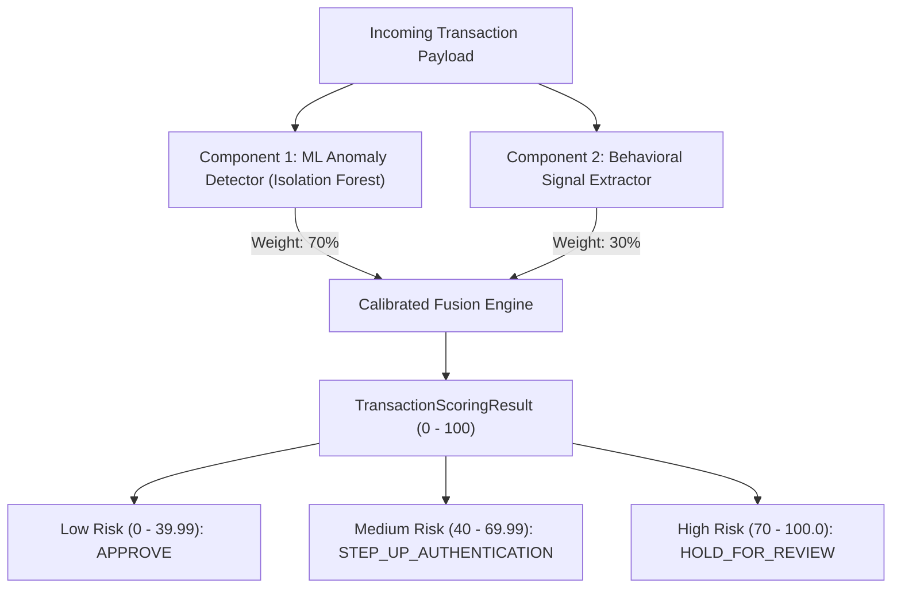

# FraudShield AI — Transaction Risk Scoring Engine Specification

---

## 1. Architectural Philosophy & Scoring Formula

FraudShield AI implements a **dual-component calibrated scoring architecture** that fuses unsupervised machine learning anomaly discovery with deterministic payment signals.

### The Calibration Formula
$$\text{Final Risk Score} = \text{clip}\Big(0.70 \cdot \text{ML\_Risk\_Component} + 0.30 \cdot \text{Domain\_Signal\_Points}, \; 0, \; 100\Big)$$

- **Component 1: ML Anomaly Component (70% Weight)**: Derived from the 200-tree Scikit-Learn Isolation Forest decision function. Inverts the tree isolation path length into a continuous percentile rank (0.0 to 100.0).
- **Component 2: Behavioral Signals Component (30% Weight)**: Evaluates orthogonal domain rules that add bounded penalty points (0 to 100) based on contextual indicators (new hardware, velocity bursts, collect requests, midnight window).

---

## 2. The Three Documented Risk Levels

| Risk Level | Score Boundary | Recommended Action | Operational Handling |
| :--- | :--- | :--- | :--- |
| **Low risk** | `0.00 - 39.99` | **`APPROVE`** | Seamless automated approval. Zero customer friction. |
| **Medium risk** | `40.00 - 69.99` | **`STEP_UP_AUTHENTICATION`** | Soft alert. Prompts user for in-app biometric authentication or SMS OTP confirmation before payment release. |
| **High risk** | `70.00 - 100.00` | **`HOLD_FOR_REVIEW`** | Hard alert. Transaction is temporarily placed on security hold and enqueued into the SOC analyst dashboard. |

---

## 3. Strict Separation of Model Predictions and Rule Indicators

In compliance with software architecture principles:
- **`anomaly_prediction`**: Contains the pure machine learning model outputs (`is_anomaly`: bool, `raw_decision_score`: float, `model_risk_contribution`: float).
- **`relevant_risk_indicators` & `detailed_indicators`**: Contain human-readable rule and signal attributions (`code`, `severity`, `description`, `impact_score`).
- This separation prevents black-box confusion: a SOC analyst can immediately distinguish whether a flag was triggered by an algorithmic multi-dimensional outlier, a deterministic rule violation (e.g. 8 transactions in 10 minutes), or a compound synthesis of both.

---

## 4. Preventing Amount Bias (Why Amount Alone Never Dictates the Score)

A common design flaw in naive fraud systems is arbitrarily penalizing high amounts:
- In FraudShield AI, an absolute amount of ₹35,000 sent by an affluent business customer whose 30-day average is ₹30,000 yields an amount ratio of **1.16x** $\implies$ **Low risk (Score < 30)**.
- Conversely, a smaller transfer of ₹6,500 sent by a user with a historical average of ₹400 represents a **16.25x spike** $\implies$ flagged as an anomalous burst.
- This **relative baseline normalization** ($\frac{\text{amount}}{\max(10, \mu_{\text{user}})}$) ensures high-wealth users are not harassed while compromised accounts are caught regardless of payment magnitude.

---

## 5. Behavioral Risk Indicator Catalog

| Indicator Code | Severity | Trigger Condition | Rationale |
| :--- | :--- | :--- | :--- |
| `AMOUNT_SPIKE_EXTREME` | **HIGH** | $\text{Amount} \ge 8.0\times \text{User Average}$ | Extreme divergence from personal spending habits. |
| `VELOCITY_BURST_CRITICAL` | **HIGH** | $\ge 6 \text{ transactions in 15 min}$ | Automated account drain pattern. |
| `NEW_DEVICE_HARDWARE_MISMATCH` | **HIGH** | Hardware signature not in verified devices | SIM swap / credential takeover indicator. |
| `OFF_PEAK_SLEEP_HOURS` | **MEDIUM** | Initiated between 01:00 AM – 04:59 AM | Off-peak nocturnal drain attack window. |
| `COLLECT_REQUEST_CHANNEL` | **MEDIUM** | Payment channel is `COLLECT_REQUEST` | High-frequency UPI phishing vector. |
| `NEW_BENEFICIARY_VPA` | **LOW** | Recipient has not been paid before | First-time transfer to unfamiliar account. |
